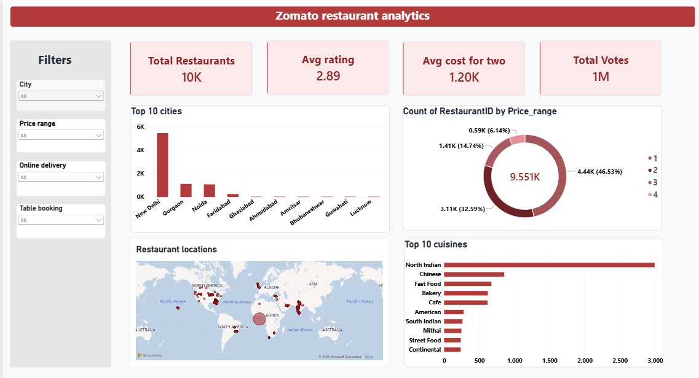
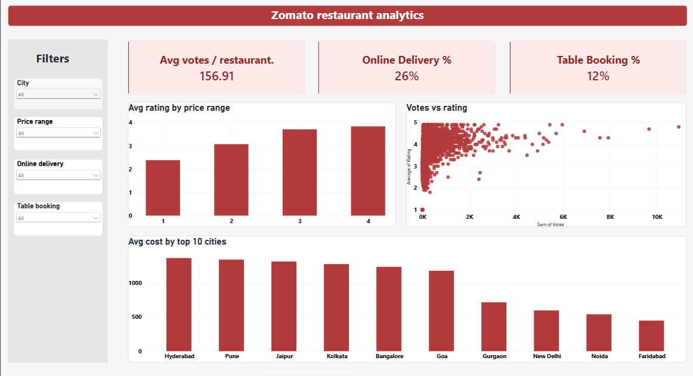

# Zomato Restaurant Analytics Dashboard

An interactive two-page Power BI dashboard built on 9,551 Zomato restaurant records. It uses KPI cards, synchronized slicers, charts, a scatter plot and a map to explore restaurant distribution, pricing, cuisines, ratings, customer engagement and service availability.

**Project type:** Data Analytics | Business Intelligence | Power BI | Data Visualization

---

## Dashboard Preview

### Page 1: Zomato Restaurant Analytics



### Page 2: Ratings and Cost Deep Dive



---

## Dashboard Pages

### Page 1: Zomato Restaurant Analytics
High-level overview of the dataset.

- **KPI cards:** Total Restaurants, Avg Rating, Avg Cost for Two, Total Votes
- **Visuals:** Top 10 Cities, Price Range Split (donut), Restaurant Locations Map, Top 10 Cuisines
- **Filters:** City, Price Range, Online Delivery, Table Booking

### Page 2: Ratings and Cost Deep Dive
Focus on ratings, votes, service availability and cost.

- **KPI cards:** Avg Votes / Restaurant, Online Delivery %, Table Booking %
- **Visuals:** Avg Rating by Price Range, Votes vs Rating (scatter plot), Avg Cost by Top 10 Cities

Slicers are synchronized across both pages, and all KPIs recalculate dynamically from the selected filters.

---

## Key Metrics

Values below are with no filters applied.

| Metric | Value |
|---|---:|
| Total Restaurants | 9,551 |
| Average Rating | 2.89 |
| Average Cost for Two | 1.20K (mixed currencies, see Data Notes) |
| Average Votes per Restaurant | 156.91 |
| Total Votes | ~1.5M (156.91 x 9,551; the KPI card shows a rounded "1M") |
| Online Delivery Availability | 26% |
| Table Booking Availability | 12% |

---

## Key Findings

Figures read from the dashboard visuals are approximate (marked with ~).

### 1. Restaurants are heavily concentrated in New Delhi
New Delhi has ~5.5K restaurants, which is over half of all 9,551 records. Gurgaon and Noida follow with ~1.1K each, and every other city has far fewer. Overall averages are therefore driven mostly by New Delhi.

### 2. Lower price ranges dominate
| Price Range | Restaurants | Share |
|---|---:|---:|
| 1 | 4.44K | 46.53% |
| 2 | 3.11K | 32.59% |
| 3 | 1.41K | 14.74% |
| 4 | 0.59K | 6.14% |

Price ranges 1 and 2 together make up 79.12% of restaurants, while only 6.14% are in the highest price range.

### 3. North Indian is by far the most common cuisine
North Indian has ~3,000 restaurant records, well ahead of Chinese (~850), Fast Food (~670), Bakery (~620) and Cafe (~610). American, South Indian, Mithai, Street Food and Continental each have ~230-270. Restaurant count shows supply, not customer demand or profitability.

### 4. Average rating rises with price range
| Price Range | Approx. Avg Rating |
|---|---:|
| 1 | 2.4 |
| 2 | 3.1 |
| 3 | 3.7 |
| 4 | 3.9 |

Higher-priced restaurants have higher average ratings. This is a correlation, not proof that price causes better ratings; food quality, service and restaurant type also matter.

### 5. Online delivery is about twice as common as table booking
26% of restaurants offer online delivery and 12% offer table booking.

### 6. Average cost for two varies widely across cities
Among the top 10 cities on page 2, Hyderabad (~1,350), Pune (~1,340) and Jaipur (~1,310) are highest, while Gurgaon (~710), New Delhi (~600), Noida (~540) and Faridabad (~450) are lowest. See the currency note below before comparing these directly.

### 7. Votes are unevenly distributed, and highly voted restaurants rate well
Most restaurants have fewer than ~2K votes and ratings between about 3 and 5. A small number of restaurants reach up to ~11K votes, and most of those are rated above 4. Votes and ratings move together, but this does not show causation.

---

## Data Notes and Limitations

- **Mixed currencies:** The dataset contains restaurants from several countries and currencies. Average cost comparisons across cities are only reliable after filtering to one currency or converting to a common one.
- **Map coordinates:** The map shows a cluster of points off the coast of Africa, which suggests some records have missing or invalid latitude/longitude values (e.g. 0, 0). These should be cleaned in Power Query.
- **Rating of 0:** If unrated restaurants are stored as a rating of 0, they pull down the average rating (2.89). This should be checked and filtered if needed.
- **Approximate values:** Chart-based values marked with ~ are read visually from the dashboard and should be verified in Power BI before being treated as exact.
- The analysis reflects this dataset only and is not a complete picture of the restaurant industry.

---

## Dataset

Restaurant dataset with 9,551 records and fields including:

`RestaurantID`, `City`, `Cuisines`, `Price_range`, `Has_Online_delivery`, `Has_Table_booking`, `Votes`, `Average_Cost_for_two`, `Rating`, `Latitude`, `Longitude`, `Currency`

> Source: [add the dataset source link here]. The dataset file is not included in this repository.

---

## Tools and Technologies

- **Microsoft Power BI Desktop:** dashboard creation, visualization and interactive analysis
- **Microsoft Excel:** source dataset
- **Power Query:** data loading and preparation
- **DAX:** calculated measures and KPI calculations

**Power BI concepts used:** KPI/card visuals, slicers, synchronized slicers, clustered column/bar charts, donut chart, scatter plot, map visualization, Top N filters, visual-level filters, DAX measures, aggregations (Count, Sum, Average), dashboard layout and visual design.

---

## Key DAX Measures

```DAX
Total Restaurants =
DISTINCTCOUNT('Sheet1'[RestaurantID])
```

```DAX
Avg Rating =
AVERAGE('Sheet1'[Rating])
```

```DAX
Avg Cost =
AVERAGE('Sheet1'[Average_Cost_for_two])
```

```DAX
Total Votes =
SUM('Sheet1'[Votes])
```

```DAX
Avg Votes per Restaurant =
AVERAGE('Sheet1'[Votes])
```

```DAX
Online Delivery % =
DIVIDE(
    CALCULATE(
        DISTINCTCOUNT('Sheet1'[RestaurantID]),
        'Sheet1'[Has_Online_delivery] = "Yes"
    ),
    DISTINCTCOUNT('Sheet1'[RestaurantID])
)
```

```DAX
Table Booking % =
DIVIDE(
    CALCULATE(
        DISTINCTCOUNT('Sheet1'[RestaurantID]),
        'Sheet1'[Has_Table_booking] = "Yes"
    ),
    DISTINCTCOUNT('Sheet1'[RestaurantID])
)
```

---

## Dashboard Design

A light, minimal theme with one consistent red color family.

| Element | Color |
|---|---|
| Header / primary red | `#B23A3A` |
| Dark red text | `#8F2525` |
| KPI card background | `#FCEAEA` |
| KPI card border | `#F1CACA` |
| Page background | `#F7F8FA` |
| Visual background | `#FFFFFF` |
| Main text | `#1F2937` |

---

## How to Use

1. Download or clone this repository.
2. Open `Zomato-Restaurant-Analytics.pbix` in **Power BI Desktop**.
3. If Power BI asks for the data source location, update the Excel file path in the data source settings.
4. Refresh the data if required.
5. Use the slicers on the left to filter the dashboard, and the tabs at the bottom to switch pages.
6. Hover over charts and data points for more detail.

---

## Repository Structure

```text
Zomato-Restaurant-Analytics-Dashboard/
├── README.md
├── Zomato-Restaurant-Analytics.pbix
├── page-1-dashboard.png
└── page-2-dashboard.png
```

---

## Future Improvements

- Standardize currencies so cost comparisons across cities are reliable
- Clean invalid map coordinates and handle unrated (0) restaurants
- Deeper analysis of ratings across cities and cuisines
- Restaurant-level drill-through pages
- Additional geographic analysis and more advanced DAX measures

---

## Author

**Shalini Nadar**
B.Sc. Data Science Student, Mumbai, India
[LinkedIn](https://www.linkedin.com/in/shalini-nadar-8a90a4378/) | [GitHub](https://github.com/shalininadar66)
